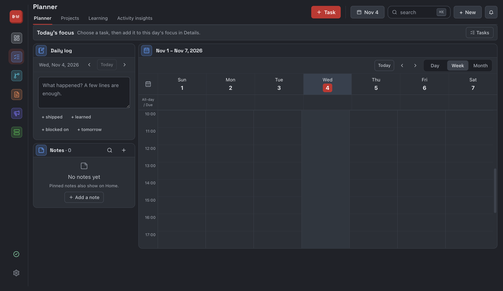
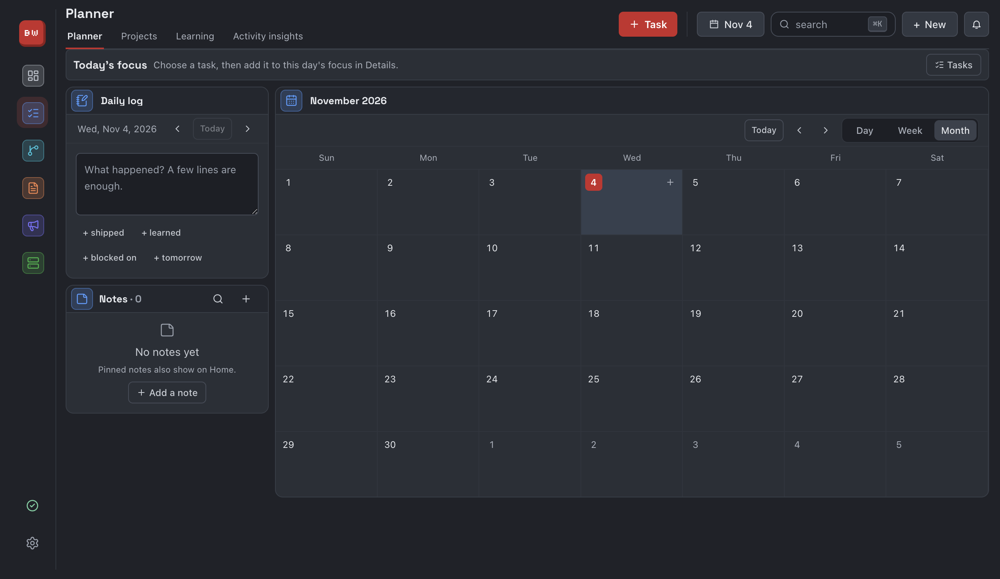

# Mac workspace: first pass

The installed Mac app now starts with a bundled Blackwall interface. Its configured server address supplies API data and sign-in; ordinary browser tabs remain available beside the pinned workspace. The Mac interface has its own `data-runtime="mac-native"` styling, so the hosted web view and Android layouts keep their existing presentation.

The first Planner layout uses a thin navigation rail, a compact utility column for the daily log, notes and selected task, and a wide week or month calendar. Panel headers and edges are closer to a small desktop tool window. The screenshot below uses an empty test workspace so it contains no personal data.

This is the starting geometry. The next design pass can bring the same window language to Learning, Home and Development, then deepen the contextual menus and modals in each area.
